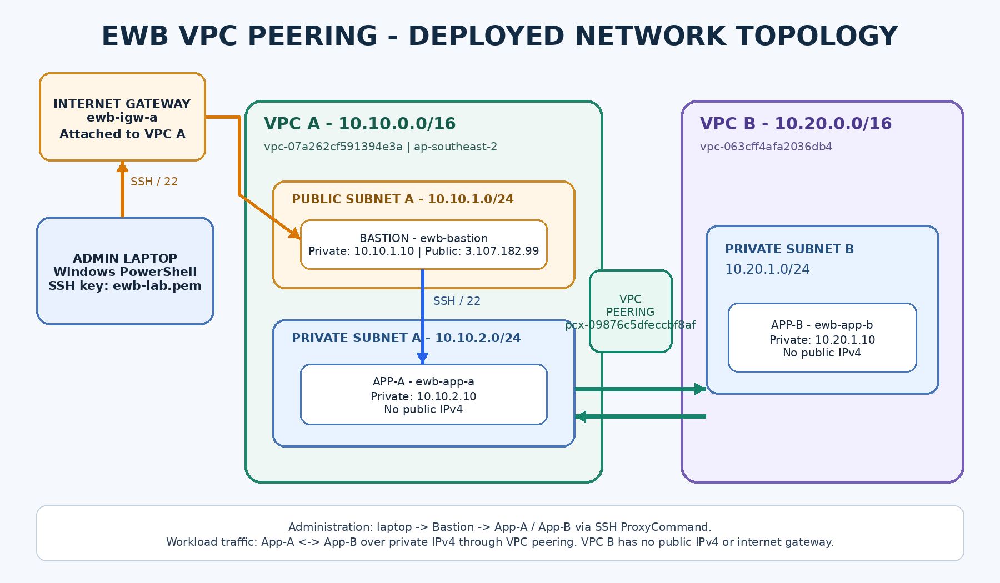

# AWS VPC Peering with Bastion Host

## Project Overview

This project demonstrates private communication between two separate Amazon Virtual Private Clouds (VPCs) using AWS VPC Peering.

A Bastion Host is deployed in the public subnet of VPC A to provide SSH access to private EC2 instances across both VPCs.

## Architecture

## AWS Services Used

- Amazon VPC
- Amazon EC2
- Internet Gateway
- VPC Peering Connection
- Route Tables
- Security Groups
- Amazon EBS

## Network Configuration

### VPC A

- CIDR Block: `10.10.0.0/16`
- Public Subnet: `10.10.1.0/24`
- Private Subnet: `10.10.2.0/24`
- Bastion Host: `10.10.1.10`
- App-A: `10.10.2.10`

### VPC B

- CIDR Block: `10.20.0.0/16`
- Private Subnet: `10.20.1.0/24`
- App-B: `10.20.1.10`

## Implementation Steps

1. Created two separate VPCs.
2. Created public and private subnets.
3. Attached an Internet Gateway to VPC A.
4. Configured public and private route tables.
5. Established an active VPC Peering Connection.
6. Updated route tables to enable communication between VPCs.
7. Configured security groups for SSH and ICMP traffic.
8. Launched three EC2 instances.
9. Configured SSH access through the Bastion Host.
10. Tested private communication between App-A and App-B.

## Connectivity Testing

| Test | Result |
|---|---|
| Windows Laptop to Bastion (SSH) | Successful |
| Bastion to App-A (SSH) | Successful |
| Bastion to App-B (SSH) | Successful |
| App-A to App-B (Ping) | Successful |
| App-B to App-A (Ping) | Successful |

### Ping Test Results

**App-A to App-B**
- Packets transmitted: 4
- Packets received: 4
- Packet loss: 0%
- Average latency: 0.254 ms

**App-B to App-A**
- Packets transmitted: 4
- Packets received: 4
- Packet loss: 0%
- Average latency: 0.267 ms

## Project Documentation

- [Project Report (PDF)](./Shekar_EWB_VPC_Peering_Project_Report.pdf)
- [Project Report (Word)](./Shekar_EWB_VPC_Peering_Project_Report.docx)
- [Complete Screenshot Collection](./Shekar_EWB_VPC_Peering_All_159_Screenshots.docx)

## Key Learning Outcomes

- AWS VPC Networking
- Subnetting and IP Addressing
- VPC Peering
- Route Table Configuration
- Security Group Configuration
- Bastion Host Architecture
- SSH Connectivity
- Private Network Communication

## Conclusion

Successfully implemented AWS VPC Peering between two independent VPCs and verified bidirectional private communication between application servers using ICMP ping tests with zero packet loss.
